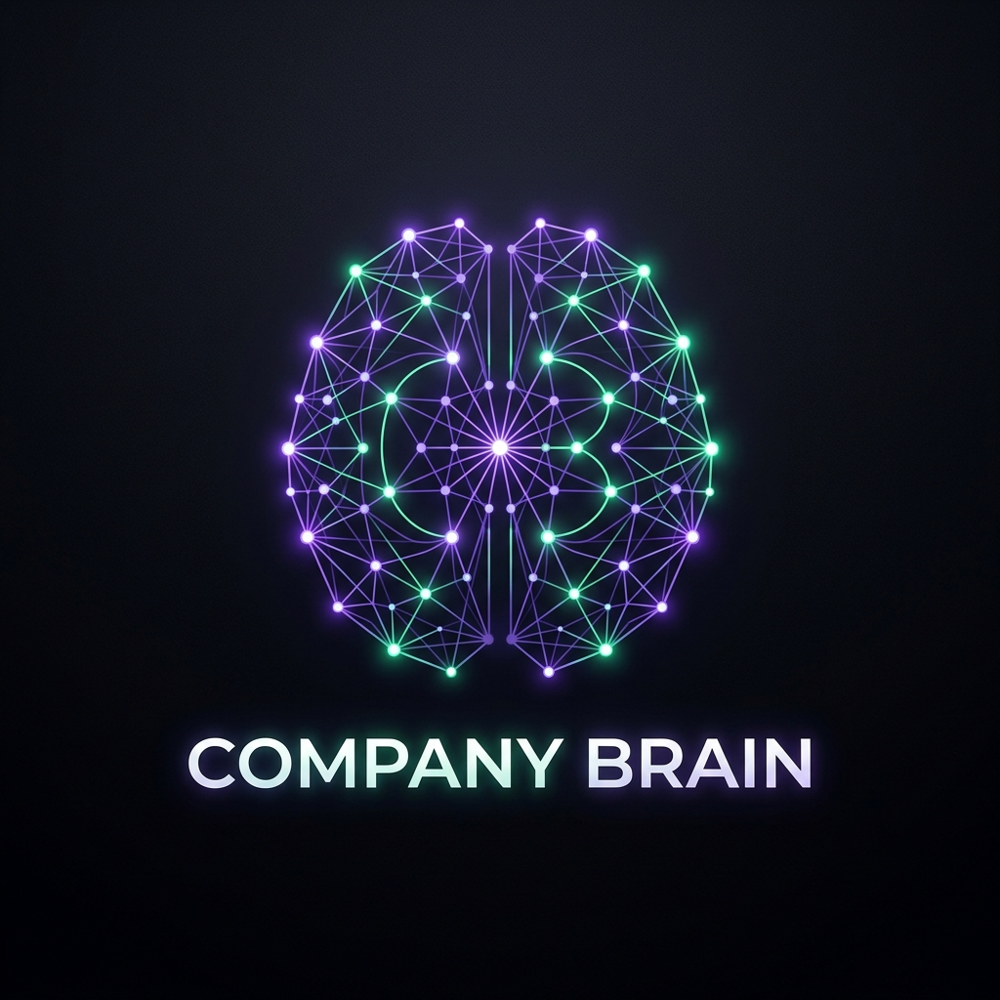
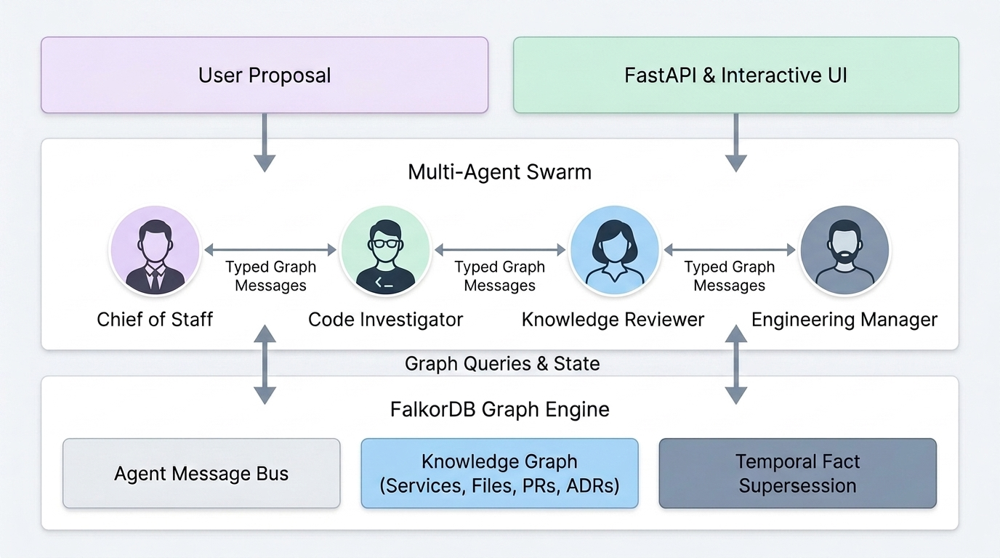

<p align="center">
  <a href="https://github.com/Pranjulchaurasiya/company-brain">
    
  </a>
</p>

<h1 align="center" style="border-bottom: none">
    Company Brain: Engineering Change Room
</h1>

<p align="center">
  <strong>The Graph-Backed Operating System & Multi-Agent Swarm Powered by FalkorDB</strong><br>
  <i>Investigate code, trace ownership, verify architectural decisions, and generate real work across your company.</i>
</p>

<div align="center">
  <a href="https://github.com/Pranjulchaurasiya/company-brain/releases"></a>
  <a href="https://www.falkordb.com/"></a>
  <a href="https://www.python.org/"></a>
  <a href="https://fastapi.tiangolo.com/"></a>
  <a href="https://docs.pytest.org/"></a>
  <a href="https://github.com/Pranjulchaurasiya/company-brain/blob/master/LICENSE"></a>
  <a href="https://github.com/Pranjulchaurasiya/company-brain/stargazers"></a>
</div>

<br />

<p align="center">
  <a href="https://company-brain-gphf.onrender.com/" target="_blank" style="margin: 0 8px;">
    
  </a>
  <a href="https://www.loom.com/share/25e8bc95d24447d2b78a268392c646a5" target="_blank" style="margin: 0 8px;">
    
  </a>
  <a href="https://discord.com/invite/Y2mMT9VdMy" target="_blank" style="margin: 0 8px;">
    
  </a>
  <a href="https://www.wemakedevs.org/hackathons/falkordb" target="_blank" style="margin: 0 8px;">
    
  </a>
  <a href="https://medium.com/@pranjulofficial01/building-an-autonomous-company-brain-how-we-turned-falkordb-into-a-shared-operating-system-68bee7595c16" target="_blank" style="margin: 0 8px;">
    
  </a>
</p>

<p align="center">
  <a href="https://company-brain-gphf.onrender.com/" target="_blank" style="margin-right: 12px;">
    
  </a>
  <a href="https://www.loom.com/share/25e8bc95d24447d2b78a268392c646a5" target="_blank">
    
  </a>
</p>
<p align="center" style="color: grey;"><i>🚀 Experience the live application directly in your browser, or click to watch the 5-minute video walkthrough.</i></p>

---

## 🌟 What is Company Brain?

> **The Core Operating Question:**  
> *“If we make this change, what will be affected, who owns it, who knows it, which architectural decision supports it, and what concrete work must happen next?”*

**Company Brain** is an enterprise graph operating system where an autonomous multi-agent swarm investigates proposed software changes, verifies claim provenance, and creates actionable work tasks. 

Unlike conventional AI tools that rely on flat vector databases or fragile in-memory agent state, **FalkorDB is the canonical operating system and message bus for the entire swarm**:

- 🧠 **Zero In-Memory Queues**: Agents communicate exclusively through persisted `(:AgentMessage)` graph nodes in FalkorDB with typed handoffs.
- 🛡️ **Four-Tier Provenance Gate**: Every factual claim is validated through `Claim → Fact → Evidence → Source` with `#Lstart-Lend` locators. Unsupported claims trigger honest abstention (*"Not documented in the company graph"*).
- 🔄 **Operational Freshness**: Ownership changes are resolved dynamically in FalkorDB via temporal fact supersession (`SUPERSEDES`), instantly re-routing tasks without vector re-indexing.
- ⚡ **Real Deliverables**: Completed investigations persist structured `(:Task)` entities directly in the graph, linked to owners, services, goals, and architectural decision records (ADRs).

---

## 📖 Table of Contents

- [🌐 Live Deployment & Cloud Access](#-live-deployment--cloud-access)
- [🎬 Video Demo & Walkthrough (Loom)](#-video-demo--walkthrough-loom)
- [✨ Key Features](#-key-features)
- [🏛️ Multi-Agent Swarm Architecture](#️-multi-agent-swarm-architecture)
- [💬 FalkorDB Agent Message Bus](#-falkordb-agent-message-bus)
- [🔬 Canonical Graph Impact Path](#-canonical-graph-impact-path)
- [🚀 Quick Start (Get Running in 3 Minutes)](#-quick-start-get-running-in-3-minutes)
- [🎮 10-Step Interactive Demo Walkthrough](#-10-step-interactive-demo-walkthrough)
- [📊 FalkorDB Data Model & Core Cypher Queries](#-falkordb-data-model--core-cypher-queries)
- [🌐 Public GitHub Ingestion & Contribution Investigator](#-public-github-ingestion--contribution-investigator)
- [🧪 Automated Test Suite (51 Passing Tests)](#-automated-test-suite-51-passing-tests)
- [📚 Architectural Documents](#-architectural-documents)
- [🤝 Community & Contributing](#-community--contributing)
- [📄 License](#-license)

---

## ✨ Key Features

- **🏛️ Engineering Change Room**: Enter any proposed change (*"Replace Redis with Valkey in Payments"*), and watch the agent swarm traverse connected services, code files, PRs, issues, owners, and ADRs.
- **💬 FalkorDB as the Message Bus**: Multi-agent communication is modeled directly as graph topology:
  `(:Employee)-[:SENT]->(:AgentMessage)-[:TO]->(:Employee)` and `(:AgentMessage)-[:FOR_TASK]->(:Task)`.
- **👥 6 Workflow Roles across 5 Persistent Employees**:
  1. **Coordinator** (`Elena Vance` — Chief of Staff): Decomposes goals into investigation plans.
  2. **Code Investigator** (`Asha Patel` — Staff Engineer): Traverses repositories, commits, PRs, and file locators.
  3. **Ownership Agent** (`Marcus Chen` — Engineering Manager): Resolves active service owners.
  4. **Knowledge Agent** (`Sophia Wu` — Knowledge Manager): Retrieves governing ADRs.
  5. **Reviewer** (`Sophia Wu` — Knowledge Reviewer): Provable provenance gate; audits evidence IDs.
  6. **Execution Agent** (`Elena Vance` / `Marcus Chen`): Persists real follow-up tasks in FalkorDB.
- **🔄 Live Operational Freshness ("Change Owner")**: 1-click demo button supersedes active ownership facts in FalkorDB. Re-running the impact analysis immediately shifts the recommended assignee, proving the graph is live operational state.
- **🌐 Public GitHub Ingestion**: Recursively imports public repositories via the Git Trees API (`/git/trees/{ref}?recursive=1`), chunking files into grounded `Evidence` nodes with `#Lstart-Lend` line locators.
- **🕵️ Engineering Contribution Investigator**: Imports commit history, PRs, touched files, and reviews. Strictly creates `RESOLVES_ISSUE` relationships only when explicitly supported by GitHub closing keywords (`fixes #N`, `closes #N`).
- **🎨 Interactive 3D Topology Studio**: Explore the entire corporate knowledge graph in real-time with an interactive visual canvas showing nodes, relationships, active owners, and superseded facts.
- **🔒 Zero-Login Judge Experience**: Completely pre-seeded with synthetic enterprise fixtures for 1-click evaluation without requiring GitHub tokens or OAuth.

---

## 🏛️ Multi-Agent Swarm Architecture

<p align="center">
  
</p>

```text
User Proposes Change: "Replace Redis with Valkey in the Payments service."
       ↓
Coordinator (Chief of Staff) creates Goal & Task in FalkorDB
       ↓ (FalkorDB AgentMessage: TASK_ASSIGNED)
Impact Investigator reads task from FalkorDB, traverses code & graph paths
       ↓ (FalkorDB AgentMessage: REVIEW_REQUEST with cited evidence)
Knowledge Reviewer validates all claims & citations against FalkorDB
       ↓ (FalkorDB AgentMessage: REVIEW_RESULT)
Coordinator / Engineering Manager creates actionable Follow-up Work Task in FalkorDB
       ↓
User Receives Canonical Impact Path + Real Work Task + Verifiable Citations
```

---

## 💬 FalkorDB Agent Message Bus

Unlike agent frameworks that store communication in transient Python variables or Redis key-value strings, Company Brain uses **graph-native message passing**:

```cypher
(:Employee)-[:SENT]->(:AgentMessage)
(:AgentMessage)-[:TO]->(:Employee)
(:AgentMessage)-[:FOR_TASK]->(:Task)
(:AgentMessage)-[:SUPPORTED_BY]->(:Evidence)
```

### The Agent Turn Contract & Flow
1. **Chief of Staff (Coordinator)**: Reads goal and graph context → Creates `(:Task)` → Writes `(:AgentMessage {message_type: 'TASK_ASSIGNED'})`.
2. **Engineering Investigator**: Reads task from FalkorDB → Executes multi-hop traversal across services and files → Writes `(:AgentMessage {message_type: 'REVIEW_REQUEST'})` citing evidence IDs.
3. **Knowledge Reviewer**: Reads investigator's request → Audits all cited evidence IDs against active FalkorDB nodes → Writes `(:AgentMessage {message_type: 'REVIEW_RESULT', status: 'APPROVED'})`.
4. **Engineering Manager**: Reads approved review from FalkorDB → Creates follow-up `(:Task)` assigned to active owner → Writes `(:AgentMessage {message_type: 'TASK_COMPLETED'})`.

---

## 🔬 Canonical Graph Impact Path

When analyzing a proposed change, Company Brain computes the complete cross-artifact breadcrumb path:

```text
Proposed Change
  → Payments Service (svc_payments_settlement)
  → redis_client.py (file_payments_redis_client)
  → PR #42 ("Migrate session store and retry cache to Redis")
  → Issue #31 ("Spike: evaluate in-memory key-value cache")
  → Asha Patel (Owner / Technical Lead)
  → ADR-0042 ("Adopt Redis for high-throughput distributed caching")
  → Follow-up Task ("Review Valkey migration impact on payment retry worker")
```

If an affected entity or decision cannot be mathematically proven through graph traversal, the system honestly abstains:
> **"Not documented in the company graph."**

---

## 🌐 Live Deployment & Cloud Access

The production Company Brain application is deployed live on Render connected to FalkorDB Cloud:

> 🚀 **Direct Live Application URL:** **[https://company-brain-gphf.onrender.com/](https://company-brain-gphf.onrender.com/)**

- **Zero Setup or Account Required**: Pre-loaded with synthetic enterprise graph fixtures (Payments, Auth, Notification services, employees, and ADRs) for instant 1-click evaluation.
- **Zero OAuth / No Login Barrier**: Direct, frictionless access to the Engineering Change Room, 3D Graph Topology Visualizer, and Multi-Agent Swarm execution logs.
- **Production Architecture**: Connected to managed FalkorDB for sub-millisecond Cypher graph traversals and real-time temporal fact updates.

---

## 🎬 Video Demo & Walkthrough (Loom)

Watch the complete 5-minute walkthrough of the 6-agent swarm, 3D topology studio, and operational freshness demo:

👉 **[https://www.loom.com/share/25e8bc95d24447d2b78a268392c646a5](https://www.loom.com/share/25e8bc95d24447d2b78a268392c646a5)**

---

## 🚀 Quick Start (Get Running in 3 Minutes)

### 1. Prerequisites
- **Python 3.11+**
- **Docker Desktop** (for running FalkorDB)

### 2. Launch FalkorDB

> **Port Guarantee:** Host port `6380` is mapped to container port `6379`.

**On Linux / macOS / WSL:**
```bash
docker run -d --name company_brain_falkordb \
  -p 6380:6379 \
  -v falkordb_data:/var/lib/falkordb/data \
  falkordb/falkordb:latest
```

**On Windows (PowerShell):**
```powershell
docker run -d --name company_brain_falkordb `
  -p 6380:6379 `
  -v falkordb_data:/var/lib/falkordb/data `
  falkordb/falkordb:latest
```

**On Windows (Command Prompt):**
```cmd
docker run -d --name company_brain_falkordb ^
  -p 6380:6379 ^
  -v falkordb_data:/var/lib/falkordb/data ^
  falkordb/falkordb:latest
```

### 3. Setup Python Environment & Seed Graph

```bash
# Clone the repository
git clone https://github.com/Pranjulchaurasiya/company-brain.git
cd company-brain

# Create and activate virtual environment
python -m venv .venv

# On Linux/macOS:
source .venv/bin/activate
# On Windows:
.venv\Scripts\activate

# Install dependencies
pip install -r requirements.txt

# Seed canonical benchmark fixtures into FalkorDB
python -m backend.ingestion.importer

# Launch the FastAPI application
python -m uvicorn backend.main:app --host 0.0.0.0 --port 8000
```

Open **`http://localhost:8000`** in your browser.

---

## 🎮 10-Step Interactive Demo Walkthrough

Follow this 10-step sequence in the UI to evaluate the complete graph-powered vertical slice:

1. **Inspect Employees & Directory**: View internal employees (Elena Vance, Asha Patel, Marcus Chen, Sophia Wu, David Kim).
2. **Explore 3D Graph Topology**: Click **Visual Graph Studio** to view connected services, ADRs, tickets, and employee ownership edges.
3. **Enter a Proposed Change**: In the **Engineering Change Room**, enter:  
   `"Replace Redis with Valkey in the Payments service."`  
   Notice the current owner badge displays `Owner: Asha Patel`.
4. **Analyze Change Impact**: Click **"Analyze Change Impact"**.
5. **Watch the Swarm Coordinate**: Coordinator (Chief of Staff) creates a Goal and posts a `TASK_ASSIGNED` message to the FalkorDB message bus.
6. **Investigator Traverses Paths**: Code Investigator traverses FalkorDB paths to locate `svc_payments_settlement`, `redis_client.py`, `PR #42`, `Issue #31`, and `ADR-0042`, posting a `REVIEW_REQUEST`.
7. **Reviewer Validates Citations**: Knowledge Reviewer audits cited evidence IDs against the database and posts `REVIEW_RESULT` with `APPROVED` status.
8. **Inspect Generated Impact Path & Task**: The UI renders the canonical impact breadcrumb and creates a new `Task` in FalkorDB:  
   `"Review Valkey migration impact on payment retry worker"`, assigned to **Asha Patel**.
9. **Trigger Operational Freshness ("Change Owner")**: Click the demo button **"Change owner"**. An operational fact supersession occurs in FalkorDB (`SUPERSEDES`), marking Marcus Chen as the active owner.
10. **Re-Run & Verify Dynamic Update**: Click **"Analyze Change Impact"** again. The canonical path and newly generated follow-up task now instantly designate **Marcus Chen** as the assignee, proving the graph is live operational state!

---

## 📊 FalkorDB Data Model & Core Cypher Queries

### Key Node Labels & Relationships

```text
(:Employee)-[:MEMBER_OF]->(:Team)
(:Employee)-[:REPORTS_TO]->(:Employee)
(:Employee)-[:HAS_SKILL]->(:Skill)
(:Employee)-[:OWNS_SERVICE]->(:Service)
(:Employee)-[:ASSIGNED_TO]->(:Task)
(:Goal)-[:DRIVES]->(:Project)
(:Project)-[:USES_SERVICE]->(:Service)
(:Document)-[:DESCRIBES_SERVICE]->(:Service)
(:Ticket)-[:TRACKS_PROJECT]->(:Project)
(:Decision)-[:ABOUT_SERVICE]->(:Service)
(:Decision)-[:SUPPORTED_BY]->(:Source)
(:Fact)-[:SUBJECT_SERVICE]->(:Service)
(:Fact)-[:OBJECT_EMPLOYEE]->(:Employee)
(:Fact)-[:SUPERSEDES]->(:Fact)
(:Fact)-[:EVIDENCED_BY]->(:Evidence)
(:AgentMessage)-[:SENT]->(:Employee)
(:AgentMessage)-[:FOR_TASK]->(:Task)
```

### Core Cypher Queries

#### 1. Current Active Owner Resolution
```cypher
MATCH (f:Fact {workspace_id: $workspace_id, predicate: 'OWNS_PROJECT', status: 'ACTIVE'})-[:SUBJECT_PROJECT]->(p:Project {id: $project_id})
MATCH (f)-[:OBJECT_EMPLOYEE]->(e:Employee {workspace_id: $workspace_id})
OPTIONAL MATCH (f)-[:EVIDENCED_BY]->(ev:Evidence)
OPTIONAL MATCH (f)-[:SUPPORTED_BY]->(s:Source)
RETURN e.id, e.name, e.title, e.department, f.id, f.valid_from, ev.excerpt, ev.locator, s.title
```

#### 2. Temporal Fact Supersession
```cypher
MATCH (old:Fact {workspace_id: $ws, id: $old_id})
SET old.status = 'SUPERSEDED', old.valid_until = $now
CREATE (new:Fact {workspace_id: $ws, id: $new_id, predicate: 'OWNS_PROJECT', status: 'ACTIVE', valid_from: $now})
CREATE (new)-[:SUPERSEDES]->(old)
CREATE (new)-[:SUBJECT_PROJECT]->(p)
CREATE (new)-[:OBJECT_EMPLOYEE]->(new_owner)
```

#### 3. Full Impact Breadcrumb Traversal
```cypher
MATCH (p:Project {workspace_id: $ws, id: $project_id})-[:USES_SERVICE]->(s:Service)
MATCH (t:Ticket {workspace_id: $ws})-[:TRACKS_PROJECT]->(p)
MATCH (d:Decision {workspace_id: $ws})-[:ABOUT_PROJECT]->(p)
MATCH (f:Fact {workspace_id: $ws, predicate: 'OWNS_PROJECT', status: 'ACTIVE'})-[:SUBJECT_PROJECT]->(p)
MATCH (f)-[:OBJECT_EMPLOYEE]->(owner:Employee)
RETURN p.name, s.name, t.title, d.outcome, owner.name, f.valid_from
```

---

## 🌐 Public GitHub Ingestion & Contribution Investigator

In addition to synthetic corporate fixtures, Company Brain includes live public GitHub ingestion engines:

| Module | Verification | Description |
|---|---|---|
| **Recursive Tree Ingestion** | ✅ **Automated Tests + Live Verified** | Ingests public repositories (e.g. `octocat/Hello-World` or `encode/httpx`) via Git Trees API (`/git/trees/{ref}?recursive=1`), chunking files into FalkorDB `Evidence` nodes with `#Lstart-Lend` locators while skipping binaries and files > 60KB. |
| **Contribution Investigator** | ✅ **Automated Tests + Live Verified** | Ingests commits, PRs, issues, touched files, and reviews. Strictly creates `RESOLVES_ISSUE` relationships only when explicitly supported by GitHub closing keywords (`fixes #N`, `closes #N`). Closers and assignees are preserved as metadata, never inferred as fix authors. |

---

## 🧪 Automated Test Suite (51 Passing Tests)

Tests execute strictly against an isolated FalkorDB test graph (`company_brain_test`), guaranteeing that production or seeded demo graphs are never corrupted:

```bash
# Run the complete test suite
pytest backend/tests/ -v
```

```text
============================== 51 passed in 4.82s ==============================
backend/tests/test_change_room.py ...............                        [ 29%]
backend/tests/test_contribution_investigator.py .......                 [ 43%]
backend/tests/test_github_ingest.py ..........                           [ 62%]
backend/tests/test_routing.py ........                                  [ 78%]
backend/tests/test_supersession_and_memory.py ...........               [100%]
```

---

## 📚 Documentation & Specifications

- 🏗️ [ARCHITECTURE.md](ARCHITECTURE.md) — Multi-agent system architecture & design
- 📊 [DATA_MODEL.md](DATA_MODEL.md) — FalkorDB schema, node labels, and relationships
- 👥 [AGENTS.md](AGENTS.md) — Employee roles, contracts, and collaboration protocol
- 📝 [BLOG_POST.md](BLOG_POST.md) — Technical deep-dive blog post (Medium / Dev.to)
- 📋 [SUBMISSION.md](SUBMISSION.md) — Complete WeMakeDevs Graph Hacks submission guide

---

## 🤝 Community & Contributing

We welcome contributions! Please review [CONTRIBUTING.md](CONTRIBUTING.md) to get started.

- 💬 **FalkorDB Discord:** [Join the FalkorDB Community](https://discord.com/invite/Y2mMT9VdMy)
- 🐛 **Issue Tracker:** [GitHub Issues](https://github.com/Pranjulchaurasiya/company-brain/issues)
- 🚀 **Discussions & Feedback:** [GitHub Discussions](https://github.com/Pranjulchaurasiya/company-brain/discussions)

---

## 📄 License

Company Brain is open-source software licensed under the **Apache License 2.0**.

---

<p align="center">
  <strong>⭐️ Star this repository if you believe the future of AI agents is graph-native! ⭐️</strong>
</p>
